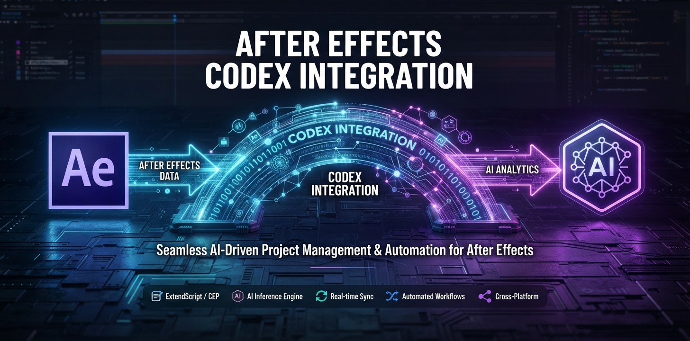

# Codex After Effects Script Bridge



Use Codex to inspect and automate Adobe After Effects through a local **ExtendScript + PowerShell connector**. Run `Start-Bridge.jsx` in After Effects once per session, then let Codex submit trusted `.jsx` scripts through `Invoke-AfterEffects.ps1`.

This project packages the existing local After Effects connector with portable paths, setup, start/stop scripts, diagnostics, saved results, tests, and GitHub CI. It is an independent integration. Adobe After Effects and Codex are installed and licensed separately.

## Requirements

| Technology | Requirement |
| --- | --- |
| Operating system | Windows |
| Adobe After Effects | ExtendScript scripting support; original connector was used with version **26.0x67** |
| PowerShell | Windows PowerShell **5.1** or PowerShell **7+** |
| Codex | A local client able to run PowerShell in the connector folder |
| Node.js | Optional, **22+**, for development tests only |
| Python / pip | Not required; `requirements.txt` documents that no Python dependencies exist |

No external PowerShell modules, npm packages, API keys, network ports, or MCP registration are needed. Codex uses its command-running capability to invoke the PowerShell client. The connector communicates through local files. Hosted chats without access to this Windows computer cannot use it.

## Install after cloning or downloading

### 1. Prepare the folder

Clone your GitHub repository or download and extract its source ZIP into a permanent, writable folder owned by your user. Open PowerShell in that folder:

```powershell
powershell.exe -NoProfile -ExecutionPolicy Bypass -File .\Setup.ps1
```

Setup creates `local/inbox`, `local/requests`, and a machine-specific `local/CODEX-SETUP.md`. It does not install software or change Adobe/Codex settings. The `-ExecutionPolicy Bypass` flag applies to that PowerShell process; it does not permanently change your system policy. Review downloaded scripts before running them. Organization policy may require administrator assistance.

### 2. Enable After Effects scripting access

In After Effects, open **Edit > Preferences > Scripting & Expressions** and enable **Allow Scripts to Write Files and Access Network**.

### 3. Start the bridge

In After Effects, choose **File > Scripts > Run Script File** and select this repository's **`Start-Bridge.jsx`**. Keep After Effects open. Repeat this step after restarting After Effects.

Keep the connector files together: run the script from the repository instead of copying only `Start-Bridge.jsx` to another directory. No CCX, ZXP, UXP Developer Tool, or extension installer is needed for this script connector.

### 4. Verify the connection

From PowerShell in the repository:

```powershell
powershell.exe -NoProfile -ExecutionPolicy Bypass -File .\Test-Connection.ps1
powershell.exe -NoProfile -ExecutionPolicy Bypass -File .\Invoke-AfterEffects.ps1
```

The first command checks the heartbeat without queuing work. The second reads project information through After Effects and should return `ok: true`, the application version, and a composition list. An unsaved project has `projectPath: null`; an empty project has no compositions. The request ID and result path are written to stderr; stdout contains JSON.

### 5. Use with Codex

Open this repository as a local Codex project and ask:

> Use this After Effects bridge to check the connection and list the active project's compositions. Do not change the project.

The included `AGENTS.md` explains how Codex should use the connector. For a Codex chat working in another folder, provide the connector path and the instructions in `local/CODEX-SETUP.md`. Codex needs filesystem access to this folder and permission to run PowerShell. It may request access if your chat's sandbox does not cover the connector folder.

For edits, save a copy of the project and describe the desired change. Codex writes a trusted ExtendScript `.jsx` file and calls:

```powershell
powershell.exe -NoProfile -ExecutionPolicy Bypass -File .\Invoke-AfterEffects.ps1 -ScriptPath .\my-edit.jsx -TimeoutSeconds 120
```

The script's last evaluated expression should be plain JSON-compatible data. See [Codex usage](docs/CODEX.md) and the [examples](examples/README.md).

## Commands

| File | Purpose |
| --- | --- |
| `Setup.ps1` | Prepare local folders and Codex instructions |
| `Start-Bridge.jsx` | Start polling in After Effects |
| `Stop-Bridge.jsx` | Stop polling; run from After Effects' Run Script File menu |
| `Test-Connection.ps1` | Report heartbeat and pending requests |
| `Invoke-AfterEffects.ps1` | Queue one script and wait for its JSON response |
| `Get-BridgeResult.ps1 -RequestId <id>` | Read an existing result without executing again |
| `project-info.jsx` | Default read-only project/composition inspection |
| `scripts/Package.ps1` | Build a source ZIP using an explicit source-file allowlist |

## Timeouts and recovery

The default wait is 120 seconds; `-TimeoutSeconds` accepts 1 through 3600. A timeout or an interrupted client **does not cancel queued or running work**. The error contains the request ID. Inspect the project and look up the saved result:

```powershell
powershell.exe -NoProfile -ExecutionPolicy Bypass -File .\Get-BridgeResult.ps1 -RequestId YOUR_32_CHARACTER_REQUEST_ID
```

Never automatically retry an edit. A queued or running request blocks additional submissions. Starting a new bridge with unresolved inbox files is also refused. See [troubleshooting](docs/TROUBLESHOOTING.md) for manual recovery.


## Development

With Node.js 22+ installed:

```powershell
npm run check
npm test
```

Use `npm.cmd` if PowerShell blocks `npm.ps1`. No `npm install` is required. The Node test runner launches actual PowerShell clients against mocked Adobe file/scripting APIs. GitHub Actions covers Windows PowerShell and PowerShell 7; it does not install or run After Effects. See [validation](docs/VALIDATION.md).

## Documentation

- [Codex workflow](docs/CODEX.md)
- [Architecture and file protocol](docs/ARCHITECTURE.md)
- [Troubleshooting and removal](docs/TROUBLESHOOTING.md)
- [Security](SECURITY.md)
- [Adobe scripting instructions](https://helpx.adobe.com/after-effects/desktop/automate-in-after-effects/automate-animation/scripts.html)

## Provenance and licensing

Based on the user's existing local After Effects bridge. The original source README records a successful read-only check on After Effects 26.0x67 on 2026-10-03; that historical result is not a fresh verification of this packaged copy. No license declaration was present in the original source. The owner should choose a license before offering open-source reuse rights. Adobe and OpenAI retain their own product terms and trademarks.
